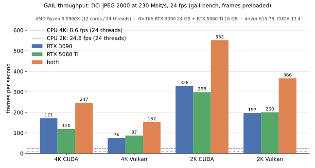

<p align="center">
  
</p>

# GAIL — GPU Accelerated Intraframe Library

A DCI JPEG 2000 encoder and decoder. GAIL turns video into **DCI-compliant JPEG 2000 codestreams** (ISO/IEC 15444-1 with the
Amd.1 cinema profiles, SMPTE ST 428-1 / ST 429-4) using the GPU for every compute-heavy
stage, including **EBCOT Tier-1 entropy coding**, and decodes such codestreams back to
pictures the same way, several times faster than real time at 4K. Encoded frames are ready
for MXF wrapping and DCP packaging (`scripts/make_dcp.py` does both with asdcplib), and
every frame is verified by an independent checker.

* **Backends:** Vulkan compute (portable: NVIDIA / AMD / Intel; needs 32-wide subgroups),
  CUDA (optional, fastest on NVIDIA; Maxwell / GTX 750 and newer, as two
  [plugins](#cuda-plugins) next to the library), CPU (reference; Tier-1 coding is
  bit-exact with both GPU backends).
* **Multi-GPU:** every GPU runs several frames in flight; a pull scheduler hands frames to
  whichever device is free, so mixed GPUs are used fully.
  Frames in flight are sized to the device memory that is free (a 4K frame takes ~0.7 GB),
  leaving headroom for other programs on the GPU, and are given up while encoding when
  those programs need the memory back (see [docs/DESIGN.md](docs/DESIGN.md)).
* **Profiles:** 2K (1998×1080 flat, 2048×858 scope, 2048×1080 full) and 4K
  (3996×2160, 4096×1716, 4096×2160), 12-bit X'Y'Z', 24/25/30/48… fps rate control
  under the 250 Mbit/s limit (230 Mbit/s target by default).
* **Color:** BT.709 / BT.2020 / P3 sources, SDR (BT.1886, sRGB) and HDR (PQ, HLG). HDR is
  handled like DCP-o-matic by default; optional tone curves and soft gamut compression
  give a true HDR rendering. Also exact X'Y'Z' pass-through or an app-supplied 3D LUT; native Y'CbCr (4:2:0, 4:2:2,
  4:4:4) and planar R'G'B' are converted on the GPU, so FFmpeg only decodes. See [docs/COLOR.md](docs/COLOR.md).
* **Library (v1):** `libgail.so` / `libgail.dll` / `libgail.dylib` / `libgail.a` with one C
  header, [include/gail/gail.h](include/gail/gail.h): pull, callback or thread-safe blocking
  encoding and decoding, R'G'B' / Y'CbCr / X'Y'Z' input, pkg-config and CMake packages. Linux and Windows
  (MinGW-w64, and MSVC with CUDA) with GPUs; macOS CPU-only so far. See
  [docs/LIBRARY.md](docs/LIBRARY.md).
* **Decoder:** DCI 2K and 4K codestreams (GAIL's own and other encoders') to 12-bit
  X'Y'Z' pictures on CUDA, Vulkan or the CPU, at full, half or quarter size. The picture
  is within one code value of what the OpenJPEG and FFmpeg decoders give. Codestreams are
  treated as untrusted input: a damaged frame fails on its own.
* **Works in FFmpeg:** a `-c:v libgail` encoder and decoder for FFmpeg
  ([integrations/ffmpeg](integrations/ffmpeg/README.md)): encoding up to 17× faster than
  FFmpeg's OpenJPEG encoder at 4K, with output that is actually DCI-compliant, and
  decoding a 4K DCP several times faster than FFmpeg's own JPEG 2000 decoder.

## Results

*Test system: AMD Ryzen 9 5900X (12 cores / 24 threads), NVIDIA RTX 3090 24 GB + RTX 5060 Ti 16 GB, driver 615.78, CUDA 13.4.*

Real 4K HDR (PQ, BT.2020, 2000 cd/m²) H.264 footage, encoded at 230 Mbit/s, 24 fps.
Encoder throughput with frames preloaded (`gail-bench`), frames per second:



| Profile | Backend | RTX 3090 | RTX 5060 Ti | both GPUs |
|---|---|---:|---:|---:|
| 4K 3996×2160 | CUDA   | 171 | 120 | **247** |
| 4K 3996×2160 | Vulkan |  76 |  87 | 152 |
| 2K 1998×1080 | CUDA   | 329 | 299 | **552** |
| 2K 1998×1080 | Vulkan | 197 | 200 | 366 |
| 4K / 2K      | CPU reference (24 threads) | | | 8.6 / 25 |

End to end from the H.264 file (decode included, both GPUs): **127 fps at 4K** (5.3×
real time), 147 fps at 2K — FFmpeg's H.264 decode is the limit there.

Quality against OpenJPEG's own DCI cinema encoder on identical X'Y'Z' frames, same
250 Mbit/s cap, decoded with OpenJPEG: GAIL **+0.05 dB (4K) / +0.03 dB (2K)** mean PSNR
while staying under the byte limit; OpenJPEG 2.5.4 overshoots the limit by up to 16 bytes on
some frames. OpenJPEG encodes 1.5 fps (4K) using all 24 CPU threads.

Validation of the full 30 s clip (720 frames) at 2K and 4K — all passed
([docs/VALIDATION.md](docs/VALIDATION.md)): own DCI checker, jpylyzer (every frame valid, every DCI
property verified), OpenJPEG and FFmpeg decoders (agree to 90 dB; PSNR mean 55.9 dB at 4K,
65.3 dB at 2K), SMPTE MXF wrapping with asdcp-wrap, libdcp `dcpverify` on the resulting
DCP (no notes; "every frame safely under 250 Mbit/s") and DCP-o-matic's verifier
(0 errors, 0 Bv2.1 errors, 0 warnings).

Decoder throughput on 4K and 2K DCP picture tracks at 250 Mbit/s (made by DCP-o-matic),
frames preloaded (`gail-dec`), frames per second, with FFmpeg's own decoder on the same
machine for scale:

| Profile | Decoder | RTX 3090 | RTX 5060 Ti | both GPUs |
|---|---|---:|---:|---:|
| 4K 3996×2160 | GAIL, CUDA   | 121 | 57 | **160** |
| 4K 3996×2160 | GAIL, Vulkan | 101 | 52 | 149 |
| 2K 1998×1080 | GAIL, CUDA   | 190 | 92 | **253** |
| 2K 1998×1080 | GAIL, Vulkan | 155 | 85 | 237 |
| 4K / 2K      | GAIL, CPU (24 threads) | | | 15 to 22 / 29 to 43 |
| 4K / 2K      | FFmpeg `jpeg2000` (24 threads) | | | 13 to 18 / 31 to 44 |

The two CPU rows are ranges because they move with whatever else the machine is doing;
the GPU rows barely do. A 4K track decodes at 301 fps at half size on both GPUs
(`--reduce 1`). Through FFmpeg with `-c:v libgail`, a whole 30 s 4K track decodes at 121
to 137 fps. Method and per-stage times are in
[docs/BENCHMARKS.md](docs/BENCHMARKS.md#decoding).

Playback of GAIL-encoded 4K DCPs has been tested on Christie Solaria One, CP2210 and CP2220
and NEC NC900C-A projectors, a GDC SR-1000 media block and ScreenWriter Plus 2.7.5-1983
([details](docs/VALIDATION.md#playback-on-cinema-hardware)).

## Build

Prebuilt archives of every release (Linux x86_64, Windows x64 built with MSVC and with
MinGW-w64, macOS arm64), each holding the library, header, `gail.pc` and the tools, with a
`SHA256SUMS` file, are on the [releases page](https://github.com/Josephur/libgail/releases);
[CHANGELOG.md](CHANGELOG.md) lists what changed in each. To build from source:

Requirements: CMake ≥ 3.20, a C++20 compiler, Vulkan SDK headers + `glslc`, FFmpeg
(`ffmpeg`, `ffprobe`) at run time. Optional, for the CUDA backend: the CUDA 13 toolkit
(Turing and newer GPUs), the CUDA 12.9 toolkit (Maxwell, Pascal, Volta), or both.

```bash
cmake -S . -B build -G Ninja
```

```bash
cmake --build build
```

A CUDA toolkit that CMake finds is used automatically and builds the plugin it is for.
`-DGAIL_CUDA13_ROOT=...` and `-DGAIL_CUDA12_ROOT=...` name a CUDA 13 and a CUDA 12.9 toolkit
to build both plugins; `-DGAIL_ENABLE_CUDA=OFF` skips CUDA. Vulkan can be disabled with
`-DGAIL_ENABLE_VULKAN=OFF`.

At run time: CUDA needs an NVIDIA GPU of the Maxwell generation or newer and the driver
its plugin asks for (see [CUDA plugins](#cuda-plugins)); Vulkan needs a Vulkan 1.3 GPU
(NVIDIA Pascal and later; AMD and Intel untested); otherwise the CPU does the work.
Details, including what is tested: [Supported hardware](docs/LIBRARY.md#supported-hardware).

`cmake --install build` installs the library, header, `gail.pc` and the CMake package.
Windows builds cross-compile with MinGW-w64 (`-DCMAKE_TOOLCHAIN_FILE=cmake/mingw-w64-x86_64.cmake`)
or natively with MSVC (needed for CUDA on Windows); macOS builds CPU-only with
`-DGAIL_ENABLE_VULKAN=OFF`. Details in [docs/LIBRARY.md](docs/LIBRARY.md).

### CUDA plugins

The CUDA backend is not inside the gail library. It is two plugin files that sit next to
it, one per CUDA toolkit, because CUDA 13 no longer builds for the GPU generations before
Turing. Maxwell, Pascal and Volta GPUs use the CUDA 12.9 plugin; Turing and newer use the
CUDA 13.4 plugin:

| Plugin file, Windows / Linux | CUDA toolkit | GPU generations | Compute capability | Example cards | Minimum NVIDIA driver, Windows | Minimum NVIDIA driver, Linux |
|---|---|---|---|---|---|---|
| `gail_cuda12.dll` / `libgail_cuda12.so` | 12.9 | Maxwell, Pascal, Volta | 5.0 – 7.0 | GTX 750 Ti, GTX 950 – 980 Ti, GT 1030, GTX 1050 – 1080 Ti, Titan X / Xp / V, Quadro M and P series, Tesla M40, P4, P40, P100, V100 | 576.57 | 575.57.08 |
| `gail_cuda13.dll` / `libgail_cuda13.so` | 13.4 | Turing, Ampere, Ada, Blackwell | 7.5 and up | GTX 1650 – 1660 Ti, RTX 20, 30, 40 and 50 series, Quadro RTX, RTX A and RTX PRO series, T4 | 580 | 580 |

* **The GTX 16 series is Turing**, so it uses `gail_cuda13`.
* **Drivers:** the versions are the ones NVIDIA's CUDA Toolkit release notes give, the
  driver that goes with CUDA 12.9 and the oldest one CUDA 13 applications run on. NVIDIA
  has named R580 as the last driver branch for Maxwell, Pascal and Volta, so those GPUs
  stay on a 580-series driver, which runs `gail_cuda12`.
* **Fallback:** a GPU that no plugin can run, a plugin file that is missing, and a machine
  without an NVIDIA driver are not errors. When CUDA can run none of the GPUs, they are
  used through Vulkan, and without a usable GPU the CPU does the work. Which backend runs
  changes the speed, not
  the encoder: the CUDA plugins, Vulkan and the CPU all write DCI-compliant
  codestreams, and their Tier-1 coding is bit-identical
  ([docs/VALIDATION.md](docs/VALIDATION.md)).
* **Shipping:** an application that ships libgail ships both plugin files in the same
  directory as the gail library. That directory is the only place the library looks for
  them.
* **Checking:** `gail-enc --list-devices` shows which plugin serves each GPU, which
  plugins are loaded, and any GPU that CUDA cannot use, with the reason:

  ```
  cuda   0: NVIDIA GeForce RTX 4070  GPU-6c7b3f1a-0d3e-6b5c-1f4e-9a8b7c6d5e4f  0000:01:00.0  [gail_cuda13]
  cuda   1: NVIDIA GeForce GTX 1080 Ti  GPU-0f1e2d3c-4b5a-6978-8796-a5b4c3d2e1f0  0000:02:00.0  [gail_cuda12]
  cuda: gail_cuda13 loaded: CUDA 13.4.92, sm 75 86 89 120
  cuda: gail_cuda12 loaded: CUDA 12.9.86, sm 50 52 60 61 70
  ```

More in [docs/LIBRARY.md](docs/LIBRARY.md#cuda-plugins).

## Usage

```bash
./build/gail-enc -i input.mkv -o frames/ --profile 4k --fps 24
```

Useful options (`gail-enc --help` for all): `--profile 2k|4k`, `--container flat|scope|full`,
`--backend auto|cuda|vulkan|cpu`, `--gpus` (indices, or UUIDs / PCI bus IDs as `--list-devices` shows them), `--slots N` (frames in flight per device, fewer when they do not fit the free device memory), `--device-memory MB` (cap that memory per GPU),
`--threads N` (CPU backend threads; default: the cores the process may use), `--low-priority` (encoder threads below normal priority),
`--mbps N` (≤ 250), `--frames N`, `--start SEC`, `--transfer/--primaries` overrides,
`--hdr-peak NITS`, `--xyz-dir DIR` (encode raw 12-bit X'Y'Z' frames), `--dump-xyz N`
(write the X'Y'Z' reference of every Nth frame for PSNR checks).

Color (see [docs/COLOR.md](docs/COLOR.md)): `--tonemap signal|shoulder|bt2390|none`,
`--tone-norm channel|maxrgb|luminance`, `--ref-white-in N` / `--ref-white-out N` (203 → 16
cd/m² by default), `--knee F`, `--cinema-peak N`, `--sdr-white N`, `--gamut none|p3d65|dcip3`,
`--gamut-threshold F`, `--lut3d FILE.cube`.

Decode codestreams (a directory of `.j2c` files, in name order) to raw X'Y'Z' frames,
or just time the decode:

```bash
./build/gail-dec -i frames/ -o pictures/
```

```bash
./build/gail-dec -i frames/ --reduce 1
```

`gail-dec --help` lists the rest (`--info`, `--low-bits`, `--backend`, `--gpus`,
`--slots`, `--threads`, `--loops`).

Apps link `libgail` (`pkg-config gail`) and include `<gail/gail.h>`; see
[docs/LIBRARY.md](docs/LIBRARY.md) and the complete example in `tests/test_api.c`:

```c
gail_config cfg;
gail_config_defaults(&cfg);
cfg.input.format = GAIL_PIX_XYZ12;           /* or RGB48 / YUV420P10 with cfg.color */
gail_encoder* enc;
if (gail_encoder_create(&cfg, &enc) != GAIL_OK) puts(gail_last_error());
gail_frame f = {{pixels}, {0}, NULL};
gail_packet pkt;
if (gail_encoder_encode(enc, &f, &pkt) == GAIL_OK) { fwrite(pkt.data, 1, pkt.size, out); gail_packet_free(&pkt); }
gail_encoder_destroy(enc);
```

Decoding is the same in reverse, one codestream in and one picture out:

```c
gail_decoder_config dcfg;
gail_decoder_config_defaults(&dcfg);
gail_decoder* dec;
if (gail_decoder_create(&dcfg, &dec) != GAIL_OK) puts(gail_last_error());
gail_packet in = {0};
in.data = codestream; in.size = size;
gail_image img = {0};
if (gail_decoder_decode(dec, &in, &img) == GAIL_OK) { show(img.data[0], img.stride[0], img.width, img.height); gail_image_free(&img); }
gail_decoder_destroy(dec);
```

FFmpeg with the `libgail` encoder and decoder ([integrations/ffmpeg](integrations/ffmpeg/README.md)):

```bash
ffmpeg -i film.mkv -r 24 -vf scale=1920:1080 -c:v libgail -f image2 j2c/%06d.j2c
```

```bash
ffmpeg -c:v libgail -i picture.mxf -pix_fmt rgb48le pictures/%06d.tiff
```

Wrap the frames and build a SMPTE DCP, then verify it:

```bash
python3 scripts/make_dcp.py frames/ dcp/ --fps 24 --title MY_FILM_FTR-1_F_51_4K_20261029_SMPTE_OV
```

```bash
dcpverify dcp/
```

Other tools: `gail-check` (DCI codestream checker, also run on every frame inside
`gail-enc`), `gail-bench` (encoder throughput without the source's decode), `gail-tests`
(unit and bit-exactness tests), `gail-api-test` (library API). How the output was validated beyond that, with
independent decoders and verifiers, is in [docs/VALIDATION.md](docs/VALIDATION.md).

## Documentation

* [docs/DESIGN.md](docs/DESIGN.md) — pipeline, GPU Tier-1 design, rate control, multi-GPU, the decoder
* [docs/COLOR.md](docs/COLOR.md) — color modes, tone map, gamut, how the defaults were chosen
* [docs/LIBRARY.md](docs/LIBRARY.md) — the C library: building (Linux, Windows, macOS), linking, API
* [integrations/ffmpeg](integrations/ffmpeg/README.md) — building FFmpeg with the `libgail` encoder and decoder
* [docs/VALIDATION.md](docs/VALIDATION.md) — how compliance is verified, results
* [docs/BENCHMARKS.md](docs/BENCHMARKS.md) — per-stage timings and scaling
* [CHANGELOG.md](CHANGELOG.md) — what changed in each release

Audio is out of scope (handled by a separate encoder).

## License

GAIL is released under the [MIT license](LICENSE), copyright (c) 2026 Joseph Stackhouse.
Every source file carries an `SPDX-License-Identifier: MIT` line.

* `integrations/ffmpeg/libgailenc.c` and `libgaildec.c` are additionally offered under
  FFmpeg's LGPL-2.1-or-later, as FFmpeg requires for code in its tree; they carry that header.
* The CUDA runtime inside the two CUDA plugins (`gail_cuda13`, `gail_cuda12`), and inside
  the static `libgail.a` of a CUDA build, is NVIDIA's, redistributed under the CUDA EULA.
  The shared library itself contains no CUDA code.
* JPEG 2000 Part 1, the only codec here, is royalty-free under the standard's patent policy.
