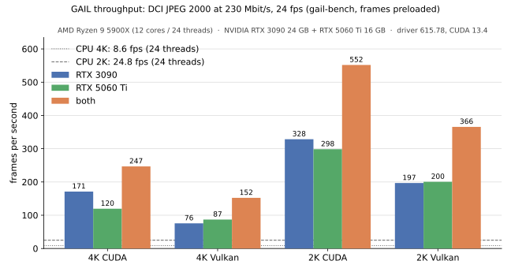

<p align="center">
  
</p>

# GAIL — GPU Accelerated Intraframe Library

A DCI JPEG 2000 encoder. GAIL turns video into **DCI-compliant JPEG 2000 codestreams** (ISO/IEC 15444-1 with the
Amd.1 cinema profiles, SMPTE ST 428-1 / ST 429-4) using the GPU for every compute-heavy
stage, including **EBCOT Tier-1 entropy coding**. Output frames are ready for MXF wrapping
and DCP packaging (`scripts/make_dcp.py` does both with asdcplib), and every frame is
verified by an independent checker.

* **Backends:** Vulkan compute (portable: NVIDIA / AMD / Intel; needs 32-wide subgroups),
  CUDA (optional, fastest on NVIDIA; Turing / GTX 16 and newer with driver 580+), CPU
  (reference, bit-exact with both GPU backends).
* **Multi-GPU:** every GPU runs several frames in flight; a pull scheduler hands frames to
  whichever device is free, so mixed GPUs are used fully.
  Frames in flight are sized to the device memory that is free (a 4K frame takes ~0.7 GB),
  leaving headroom for other programs on the GPU, and are given up while encoding when
  those programs need the memory back (see [docs/DESIGN.md](docs/DESIGN.md)).
* **Profiles:** 2K (1998×1080 flat, 2048×858 scope, 2048×1080 full) and 4K
  (3996×2160, 4096×1716, 4096×2160), 12-bit X'Y'Z', 24/25/30/48… fps rate control
  under the 250 Mbit/s limit (230 Mbit/s target by default).
* **Colour:** BT.709 / BT.2020 / P3 sources, SDR (BT.1886, sRGB) and HDR (PQ, HLG). HDR is
  handled like DCP-o-matic by default; optional tone curves and soft gamut compression
  give a true HDR rendering. Also exact X'Y'Z' pass-through or an app-supplied 3D LUT; native Y'CbCr (4:2:0, 4:2:2,
  4:4:4) and planar R'G'B' are converted on the GPU, so FFmpeg only decodes. See [docs/COLOR.md](docs/COLOR.md).
* **Library (v1):** `libgail.so` / `libgail.dll` / `libgail.dylib` / `libgail.a` with one C
  header, [include/gail/gail.h](include/gail/gail.h): pull, callback or thread-safe blocking
  encoding, R'G'B' / Y'CbCr / X'Y'Z' input, pkg-config and CMake packages. Linux and Windows
  (MinGW-w64, and MSVC with CUDA) with GPUs; macOS CPU-only so far. See
  [docs/LIBRARY.md](docs/LIBRARY.md).
* **Works in FFmpeg:** a `-c:v libgail` encoder for FFmpeg
  ([integrations/ffmpeg](integrations/ffmpeg/README.md)), up to 17× faster than FFmpeg's
  OpenJPEG encoder at 4K, with output that is actually DCI-compliant.

## Results

*Test system: AMD Ryzen 9 5900X (12 cores / 24 threads), NVIDIA RTX 3090 24 GB + RTX 5060 Ti 16 GB, driver 615.78, CUDA 13.4.*

Real 4K HDR (PQ, BT.2020, 2000 cd/m²) H.264 footage, encoded at 230 Mbit/s, 24 fps.
Encoder throughput with frames preloaded (`gail-bench`), frames per second:



| Profile | Backend | RTX 3090 | RTX 5060 Ti | both GPUs |
|---|---|---:|---:|---:|
| 4K 3996×2160 | CUDA   | 171 | 120 | **247** |
| 4K 3996×2160 | Vulkan |  76 |  87 | 152 |
| 2K 1998×1080 | CUDA   | 329 | 299 | **552** |
| 2K 1998×1080 | Vulkan | 197 | 200 | 366 |
| 4K / 2K      | CPU reference (24 threads) | | | 8.6 / 25 |

End to end from the H.264 file (decode included, both GPUs): **127 fps at 4K** (5.3×
real time), 147 fps at 2K — FFmpeg's H.264 decode is the limit there.

Quality against OpenJPEG's own DCI cinema encoder on identical X'Y'Z' frames, same
250 Mbit/s cap, decoded with OpenJPEG: GAIL **+0.05 dB (4K) / +0.03 dB (2K)** mean PSNR
while staying under the byte limit; OpenJPEG 2.5.4 overshoots the limit by up to 16 bytes on
some frames. OpenJPEG encodes 1.5 fps (4K) using all 24 CPU threads.

Validation of the full 30 s clip (720 frames) at 2K and 4K — all passed
([docs/VALIDATION.md](docs/VALIDATION.md)): own DCI checker, jpylyzer (every frame valid, every DCI
property verified), OpenJPEG and FFmpeg decoders (agree to 90 dB; PSNR mean 55.9 dB at 4K,
65.3 dB at 2K), SMPTE MXF wrapping with asdcp-wrap, libdcp `dcpverify` on the resulting
DCP (no notes; "every frame safely under 250 Mbit/s") and DCP-o-matic's verifier
(0 errors, 0 Bv2.1 errors, 0 warnings).

Playback of GAIL-encoded 4K DCPs has been tested on Christie Solaria One, CP2210 and CP2220
and NEC NC900C-A projectors, a GDC SR-1000 media block and ScreenWriter Plus 2.7.5-1983
([details](docs/VALIDATION.md#playback-on-cinema-hardware)).

## Build

Requirements: CMake ≥ 3.20, a C++20 compiler, Vulkan SDK headers + `glslc`, FFmpeg
(`ffmpeg`, `ffprobe`) at run time. Optional: CUDA 12+ (enables the CUDA backend).

```bash
cmake -S . -B build -G Ninja
```

```bash
cmake --build build
```

CUDA is detected automatically (`-DGAIL_ENABLE_CUDA=OFF` to skip it, `-DGAIL_CUDA_ARCHS=...`
to choose architectures). Vulkan can be disabled with `-DGAIL_ENABLE_VULKAN=OFF`.

At run time: CUDA needs an NVIDIA Turing-or-newer GPU (GTX 16 / RTX 20 and later) with
driver 580+; Vulkan needs a Vulkan 1.3 GPU (NVIDIA Pascal and later; AMD and Intel untested);
otherwise the CPU does the work. Details, including what is tested:
[Supported hardware](docs/LIBRARY.md#supported-hardware).

`cmake --install build` installs the library, header, `gail.pc` and the CMake package.
Windows builds cross-compile with MinGW-w64 (`-DCMAKE_TOOLCHAIN_FILE=cmake/mingw-w64-x86_64.cmake`)
or natively with MSVC (needed for CUDA on Windows); macOS builds CPU-only with
`-DGAIL_ENABLE_VULKAN=OFF`. Details in [docs/LIBRARY.md](docs/LIBRARY.md).

## Usage

```bash
./build/gail-enc -i input.mkv -o frames/ --profile 4k --fps 24
```

Useful options (`gail-enc --help` for all): `--profile 2k|4k`, `--container flat|scope|full`,
`--backend auto|cuda|vulkan|cpu`, `--gpus` (indices, or UUIDs / PCI bus IDs as `--list-devices` shows them), `--slots N` (frames in flight per device, fewer when they do not fit the free device memory), `--device-memory MB` (cap that memory per GPU),
`--threads N` (CPU backend threads; default: the cores the process may use), `--low-priority` (encoder threads below normal priority),
`--mbps N` (≤ 250), `--frames N`, `--start SEC`, `--transfer/--primaries` overrides,
`--hdr-peak NITS`, `--xyz-dir DIR` (encode raw 12-bit X'Y'Z' frames), `--dump-xyz N`
(write the X'Y'Z' reference of every Nth frame for PSNR checks).

Colour (see [docs/COLOR.md](docs/COLOR.md)): `--tonemap signal|shoulder|bt2390|none`,
`--tone-norm channel|maxrgb|luminance`, `--ref-white-in N` / `--ref-white-out N` (203 → 16
cd/m² by default), `--knee F`, `--cinema-peak N`, `--sdr-white N`, `--gamut none|p3d65|dcip3`,
`--gamut-threshold F`, `--lut3d FILE.cube`.

Apps link `libgail` (`pkg-config gail`) and include `<gail/gail.h>`; see
[docs/LIBRARY.md](docs/LIBRARY.md) and the complete example in `tests/test_api.c`:

```c
gail_config cfg;
gail_config_defaults(&cfg);
cfg.input.format = GAIL_PIX_XYZ12;           /* or RGB48 / YUV420P10 with cfg.color */
gail_encoder* enc;
if (gail_encoder_create(&cfg, &enc) != GAIL_OK) puts(gail_last_error());
gail_frame f = {{pixels}, {0}, NULL};
gail_packet pkt;
if (gail_encoder_encode(enc, &f, &pkt) == GAIL_OK) { fwrite(pkt.data, 1, pkt.size, out); gail_packet_free(&pkt); }
gail_encoder_destroy(enc);
```

FFmpeg with the `libgail` encoder ([integrations/ffmpeg](integrations/ffmpeg/README.md)):

```bash
ffmpeg -i film.mkv -r 24 -vf scale=1920:1080 -c:v libgail -f image2 j2c/%06d.j2c
```

Wrap the frames and build a SMPTE DCP, then verify it:

```bash
python3 scripts/make_dcp.py frames/ dcp/ --fps 24 --title MY_FILM_FTR-1_F_51_4K_20261029_SMPTE_OV
```

```bash
dcpverify dcp/
```

Other tools: `gail-check` (DCI codestream checker, also run on every frame inside
`gail-enc`), `gail-bench` (throughput without decode), `gail-tests` (unit and bit-exactness
tests), `gail-api-test` (library API). How the output was validated beyond that, with
independent decoders and verifiers, is in [docs/VALIDATION.md](docs/VALIDATION.md).

## Documentation

* [docs/DESIGN.md](docs/DESIGN.md) — pipeline, GPU Tier-1 design, rate control, multi-GPU
* [docs/COLOR.md](docs/COLOR.md) — colour modes, tone map, gamut, how the defaults were chosen
* [docs/LIBRARY.md](docs/LIBRARY.md) — the C library: building (Linux, Windows, macOS), linking, API
* [integrations/ffmpeg](integrations/ffmpeg/README.md) — building FFmpeg with the `libgail` encoder
* [docs/VALIDATION.md](docs/VALIDATION.md) — how compliance is verified, results
* [docs/BENCHMARKS.md](docs/BENCHMARKS.md) — per-stage timings and scaling

Audio is out of scope (handled by a separate encoder).

## Licence

GAIL is released under the [MIT licence](LICENSE), copyright (c) 2026 Joseph Stackhouse.
Every source file carries an `SPDX-License-Identifier: MIT` line.

* `integrations/ffmpeg/libgailenc.c` is additionally offered under FFmpeg's LGPL-2.1-or-later,
  as FFmpeg requires for code in its tree; it carries that header.
* The CUDA runtime inside `libgail` is NVIDIA's, redistributed under the CUDA EULA.
* JPEG 2000 Part 1, the only codec here, is royalty-free under the standard's patent policy.
